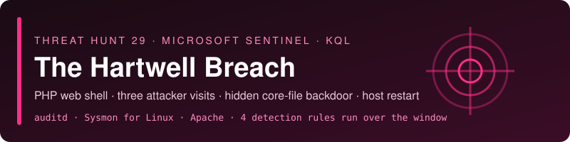

<p align="center">
  
</p>

<p align="center">
  
  
  
  
</p>

# Hunt 29: The Hartwell Breach

**An attacker broke into a WordPress server, came back twice in the same day, and left a hidden backdoor that the first cleanup missed.**

A hypothesis-driven threat hunt in Microsoft Sentinel on a WordPress web server (Debian, Apache, PHP). Twelve hours of Apache, auditd, Sysmon for Linux, syslog and authentication telemetry, all queried in KQL.

---

## The 60-second version

Someone already inside the network broke into the website server and planted a web shell, a hidden page that let them run commands on the server from a browser. Over three visits in one day they read the password the website uses to reach its database, read the scrambled (hashed) versions of the website's user passwords, and left a ransom note, although no encryption was seen. On the first visit they also hid a second way back in inside one of WordPress's own core files, and the first cleanup missed it. The website's user data and configuration were very likely, not proven, taken: the attacker packaged them for sending, but the server does not record what it sends back, so the theft cannot be confirmed. Take the server out of service, rebuild it from a known-good image, and rotate the database password and all website and administrator credentials before it returns. Before rebuilding, copy the implant from /dev/shm, the crontabs, the web root and the logs, because /dev/shm is wiped on reboot.

---

## How the attack unfolded

**Visit 1: in and out in eight minutes (04:32 to 04:40).** At 04:32:44 an Nmap scan started from a host inside the network. Under two minutes later, at 04:34:31, the attacker used an SSH session with sudo to write `health-check.php` into the web root as root, then handed it to the web server account. Three seconds after that, they were running commands through it. They downloaded an implant from a local port, checked for security tools, read the database settings and `/etc/shadow`, and dumped and archived the user table. Then they cleaned up after themselves: they copied the timestamp of `wp-login.php` onto the shell so it matched a real WordPress file, moved the implant to `/dev/shm/.cache-helper`, ran commands to clear the audit rules and stop Sysmon, and wiped their shell history. They base64-encoded the config file and the dump, then deleted them. In the last step, at 04:37:19, they added a cron job that runs every 5 minutes, wrote a cookie-triggered backdoor into the WordPress core file `version.php`, and left a ransom note.

**Visit 2: a second try, then everything went dark (12:18 to 12:26).** From 12:18:05 to 12:19:47 the Apache error log, once its clock is corrected by four hours, shows upload exploit attempts against PHP session handling. From 12:21 the attacker was back at work: more discovery, a search for SSH keys, a fresh copy of the implant, and attempts to stop Sysmon, auditd and the Splunk forwarder. At 12:27 every log source went silent for 77 minutes. It looked like the forwarder had been stopped. The audit serial numbers and process IDs said otherwise: both reset when logging returned at 13:44, which means the host had restarted. From 13:49 to 13:52 a responder removed the shell, the ransom note and the crontab. The responder did not name `version.php`.

**Visit 3: the longest one (13:52 to 15:07).** The attacker returned as the cleanup finished. A second scan burst, more upload exploit attempts, and then the web shell was back. They staged the data again, rewrote the ransom note, and read through the server's logs for traces of their own activity.

Full timeline, to the second: **[docs/timeline.md](docs/timeline.md)**

---

## What I found that others might miss

- **The backdoor that survived the cleanup lives in a WordPress core file.** The obvious shell sat in the web root. The second way in was a cookie-triggered backdoor inside `wp-includes/version.php`, a file that ships with WordPress itself, and the first cleanup did not name it. A cleanup that removes only the shell leaves this way in open.
- **The 77-minute silence was a reboot, and the counters proved it.** The quiet started right after the attacker tried to stop the Splunk forwarder, so a stopped forwarder was the obvious answer. Audit serial numbers and process IDs reset when logging came back. Those counters only reset on a restart.
- **Sysmon missed the entire first visit.** Sysmon starts recording at 05:24, and visit 1 was over by 04:40. The shell, the implant, the cron job and the backdoor are visible in auditd only. Anyone hunting in Sysmon alone would start the story at the second visit and miss where the persistence was planted.
- **Data theft is very likely, not proven.** The config file and user table were archived and base64-encoded, and the HTTP response sizes fit that output being sent back. Response bodies are not logged and network events have no destination, so the data leaving the server cannot be shown. I say exactly that.

---

## Detections

I built each rule from a finding, wrote it in KQL, and ran it over the hunt window (2026-10-23, 04:00 to 16:00 UTC). The results below are what each rule returned over that window, hits and misses. Every query is scoped on `OriginalTime`, because `TimeGenerated` is ingestion time in this data. Each file in [`detections/`](detections/) opens with a header covering the finding, data source, result, what it missed and expected false positives.

<details>
<summary><b>Rule 1: PHP file created in the web root by any account (auditd)</b></summary>

File: [`detections/rule1_webroot_php_create.kql`](detections/rule1_webroot_php_create.kql)

```kql
HartwellAudit_CL
| where OriginalTime between (datetime(2026-10-23T04:00:00Z) .. datetime(2026-10-23T16:00:00Z))
| where AuditType == "PATH"
| where RawLine contains "name=\"/var/www/html/" and RawLine contains ".php\"" and RawLine contains "nametype=CREATE"
| project OriginalTime, AuditSerial, RawLine
| order by OriginalTime asc
```

**Result:** 6 rows.
- **Caught:** both web shell writes and the `version.php` backdoor.
- **Unexplained:** three root-created files about 24 minutes before the scan. They need checking against site maintenance before being treated as false positives.
- **Missed:** nothing it was built to catch.
- **Why it keys on any account:** both shells were written by root, so a rule limited to the web server account would have missed them.
- **Expected false positives:** WordPress core, plugin and theme updates. Exclude them by the deployment account or path once known.
</details>

<details>
<summary><b>Rule 2: command run by the web server account (auditd)</b></summary>

File: [`detections/rule2_wwwdata_exec_auditd.kql`](detections/rule2_wwwdata_exec_auditd.kql)

```kql
let execs = HartwellAudit_CL
| where OriginalTime between (datetime(2026-10-23T04:00:00Z) .. datetime(2026-10-23T16:00:00Z))
| where AuditType == "SYSCALL" and RawLine contains "syscall=59" and RawLine contains " uid=33 "
| project AuditSerial, OriginalTime;
HartwellAudit_CL
| where AuditType == "EXECVE"
| join kind=inner execs on AuditSerial, OriginalTime
| project OriginalTime, AuditSerial, RawLine
| order by OriginalTime asc
```

**Result:** 496 records covering all three visits.
- **First visit included:** Sysmon recorded nothing from that visit.
- **Cron runs:** 116 of the records are cron runs of the implant.
- **Missed:** actions taken inside PHP that start no process.
- **Expected false positives:** PHP features or plugins that shell out (image processing, mail). Allow-list those commands by name.
</details>

<details>
<summary><b>Rule 3: shell started by Apache (Sysmon)</b></summary>

File: [`detections/rule3_apache_shell_sysmon.kql`](detections/rule3_apache_shell_sysmon.kql)

```kql
HartwellSysmon_CL
| where OriginalTime between (datetime(2026-10-23T04:00:00Z) .. datetime(2026-10-23T16:00:00Z))
| where RuleName == "ProcessCreate" and ParentImage == "/usr/sbin/apache2"
| where Image in ("/usr/bin/dash", "/bin/sh", "/usr/bin/bash", "/bin/bash")
| summarize Hits=count(), First=min(OriginalTime), Last=max(OriginalTime) by User
```

**Result:** 62 hits for the web server account and 1 for root.
- **Missed the first visit:** Sysmon only starts recording at 05:24.
- **Missed the cron runs:** their parent is cron, not Apache. Rule 2 covers both.
- **Expected false positives:** the same as rule 2.
</details>

<details>
<summary><b>Rule 4: host goes silent</b></summary>

File: [`detections/rule4_host_silent.kql`](detections/rule4_host_silent.kql)

```kql
union HartwellSysmon_CL, HartwellAudit_CL, HartwellApache_CL
| make-series Events=count() default=0 on OriginalTime from datetime(2026-10-23T04:00:00Z) to datetime(2026-10-23T16:00:00Z) step 5m
| mv-expand OriginalTime to typeof(datetime), Events to typeof(long)
| where Events == 0
| summarize SilentBins=count(), First=min(OriginalTime), Last=max(OriginalTime)
```

**Result:** 15 silent 5-minute bins.
- **The restart:** 14 of the bins, from 12:30 to 13:35.
- **Unexplained:** one bin at 04:25.
- **Limit:** the rule fires on the silence, not its cause. The counters on either side of the gap are what show it was a restart.
- **Expected false positives:** planned maintenance and patch reboots. Suppress during change windows.
</details>

---

## Telemetry gaps

| Gap | Why it matters |
|---|---|
| Sysmon starts recording at 05:24 | The first visit is visible in auditd only |
| Response bodies are not logged | Data leaving the server can be sized but not read |
| Commands hidden in a custom HTTP header | The access log does not record headers, so they never appear in it |
| Error log clock is 4 hours behind | Cross-table correlation silently misaligns |
| Network events have no destination | The implant's 215 connections cannot be tied to a destination |
| No alert on loss of collection | The endpoint sensors were silent for 77 minutes and the web log for 70, and nothing alerted |

The two silence numbers measure different sources: Sysmon and auditd have no events in any one-minute bin from 12:27 to 13:43 inclusive (77 minutes); the Apache access log has none from 12:30 to 13:39 (70 minutes, matching Rule 4's 14 empty 5-minute bins). More on each gap: **[docs/telemetry-gaps.md](docs/telemetry-gaps.md)**

---

## MITRE ATT&CK (observed)

| Tactic | Techniques |
|---|---|
| Reconnaissance | T1595 Active Scanning |
| Initial Access | T1078 Valid Accounts; T1190 Exploit Public-Facing Application (attempted) |
| Execution | T1059.004 Unix Shell |
| Persistence | T1505.003 Web Shell (two); T1053.003 Cron |
| Defense Evasion | T1562.001 Disable or Modify Tools (attempted); T1562.012 Disable or Modify Linux Audit System (attempted); T1070.003 Clear Command History; T1070.006 Timestomp; T1036 Masquerading |
| Discovery | T1033, T1016, T1049, T1083, T1518.001 |
| Credential Access | T1552.001 Credentials in Files; T1003.008 /etc/passwd and /etc/shadow |
| Collection | T1560.001 Archive via Utility; T1132.001 Standard Encoding |
| Exfiltration | T1041 Exfiltration Over C2 Channel (very likely, not proven) |
| Impact | Ransom note left; no encryption observed |

---

## What I learned

1. **Check which column holds event time.** In this data `TimeGenerated` is the ingestion time, so I scoped every query on `OriginalTime`.
2. **Check the counters before you name a cause.** When every source went quiet, I first blamed the forwarder stop. The audit serial numbers and process IDs on either side of the gap had reset, and those only reset on a reboot. It was a host restart.
3. **Build detections from the findings, then run them.** My first rule watched the web server account. The shells were written by root, so it would have caught neither of them.
4. **Know when each sensor starts recording.** Sysmon missed the whole first visit. Auditd had all of it.
5. **Say "probable" when the evidence stops short.** I can show the staging and the response sizes. I cannot show the data leaving.

Each lesson in full: **[docs/lessons-learned.md](docs/lessons-learned.md)**

---

## Tools

Microsoft Sentinel · KQL · auditd · Sysmon for Linux · Apache access and error logs · MITRE ATT&CK

---

## About me

I'm Jenna Frank, a threat hunter and SOC Operations Lead. I'm building my detection engineering and threat hunting skills one hunt at a time, and I publish each write-up with its queries, its results and its mistakes.

[LinkedIn](https://www.linkedin.com/in/jenna-frank-cyber/) · [GitHub](https://github.com/jennafrank) · [JennaFrank.co](https://www.JennaFrank.co)

---

<p align="center"><b>TLP:CLEAR. Full report available on request.</b></p>
